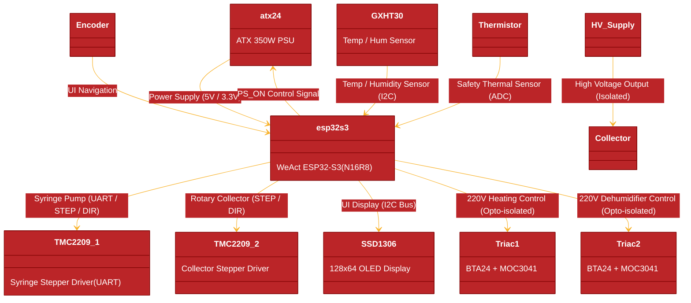

# Electrospinning Device Hardware Documentation

Hardware specification, schematic architecture, component choices, and pin assignments for the ESP32-S3 Electrospinning Control Board.

---

## 📐 Hardware Architecture Diagram

## Core Components & Drop-in Alternatives

| Subsystem | Active Component | Function / Spec | Hardware Fallbacks |
| --- | --- | --- | --- |
| **MCU** | **WeAct ESP32-S3** | ESP32-S3-N16R8 (16MB Flash, 8MB PSRAM) | ESP32-S3-DevKitC-1, Waveshare ESP32-S3-N8R2 |
| **Power Supply** | **ATX24 350W PSU** | 12V, 5V, 3.3V rails with PS_ON control | Standard ATX PSU / External 12V Buck Converters |
| **Syringe Driver** | **TMC2209 (#1)** | Syringe pump stepper driver (UART + STEP/DIR) | TMC2208 (lacks StallGuard), TMC2225 |
| **Collector Driver** | **TMC2209 (#2)** | Rotary collector stepper driver (STEP/DIR) | TMC2208, TMC2225, A4988 |
| **Environment** | **GXHT30** | I2C Temperature & Humidity Sensor | SHT30, SHT31, SHT40 |
| **Display** | **SSD1306** | 0.96" 128x64 OLED (I2C) | SH1106 (1.3"), SSD1309 (2.4") |
| **AC Control** | **BTA24 + MOC3041** | 25A Triac with Zero-Cross Optocoupler (220V AC) | MOC3063 (Opto), BTA41 (40A Triac) |
| **Safety Sensor** | **NTC Thermistor** | ADC thermal monitoring | Standard 10k NTC Thermistor |

## ESP32-S3 Pin Mapping Analysis

| Peripheral | Signal Function | GPIO | Logic Type |
| --- | --- | --- | --- |
| **I2C Bus** | SDA / SCL | GPIO 17 / GPIO 18 | Shared Bus (GXHT30 + SSD1306) |
| **TMC2209 #1** | UART TX / RX | GPIO 15 / GPIO 16 | Syringe Driver Serial Config |
| **TMC2209 #1** | STEP / DIR | GPIO 41 / GPIO 42 | Syringe High-Speed Motion Pulses |
| **TMC2209 #2** | STEP / DIR | GPIO 4 / GPIO 5 | Collector Motor Speed & Direction |
| **ATX Power** | PS_ON | GPIO 7 | PSU Power-On Switch Signal |
| **Rotary Encoder** | Phase A / Phase B / SW | GPIO 1 / GPIO 2 / GPIO 3 | UI Navigation & Push Selection |
| **AC Control 1** | Triac Trigger 1 (Heat) | GPIO 39 | Opto-isolated Gate Trigger |
| **AC Control 2** | Triac Trigger 2 (Hum) | GPIO 40 | Opto-isolated Gate Trigger |
| **Thermistor** | NTC ADC | GPIO 10 | Analog Temperature Measurement |

## Hardware Design Files & Links

* **Syringe Mechanism CAD Files**: [`Hardware/syringe/`](Hardware/syringe/)
* **EasyEDA Pro Project Backup**: [`Hardware/easyEDA_project/BackupProjects_creciunelcatalin_personal_0_20260923.eprj2`](Hardware/easyEDA_project/BackupProjects_creciunelcatalin_personal_0_20260923.eprj2)
* **3D Assembly Model (STEP)**: [`Hardware/3D_1-PCB_PCB_ESP-Electrospinning_2026-09-23.step`](Hardware/3D_1-PCB_PCB_ESP-Electrospinning_2026-09-23.step)
* **Bill of Materials (BOM)**: [`Pricing/BOM_ESP-Electrospinning_ESP-Electrospinning_2026-09-24.xlsx`](Pricing/BOM_ESP-Electrospinning_ESP-Electrospinning_2026-09-24.xlsx)